

# EYEZMAZE

**The world of On Nakayama, grown for iPhone and iPad.**

**[⬇ Download the latest release](https://github.com/second-light/EYEZMAZE-App/releases/latest)** · [All releases](https://github.com/second-light/EYEZMAZE-App/releases) · [Install](#install) · [What's inside](#whats-inside) · [Version history](#version-history)

**47 games · Free of adverts · No internet needed · iPhone, iPad and Mac**

 

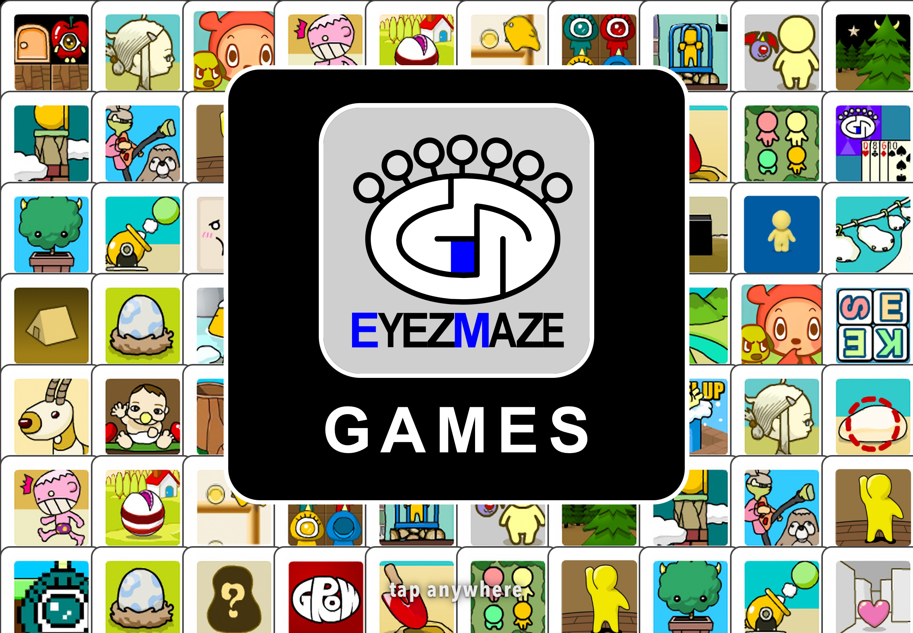

---

## Releases

| Version | Date | Highlights |
|---|---|---|
| **[2.0](https://github.com/second-light/EYEZMAZE-App/releases/tag/v2.0)** | 1 Nov 2026 | The biggest update yet: a brand-new menu based on the creator's own front page, a glow made from each game's colours, more games filling the iPad sideways, and pin-sharp web-game buttons |
| **[1.0](https://github.com/second-light/EYEZMAZE-App/releases/tag/v1.0)** | 1 Nov 2026 | First release: all 47 EYEZMAZE games on iPhone and iPad, laid out for touch, with the living hedge menu, a new opening and HD restorations |

---

## Screenshots

### iPhone

<table>
<tr>
<td width="25%">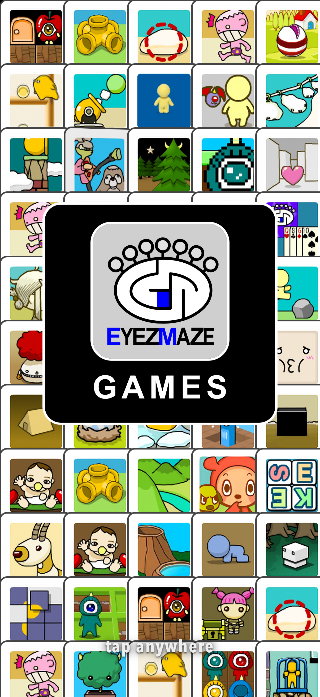 The opening</td>
<td width="25%">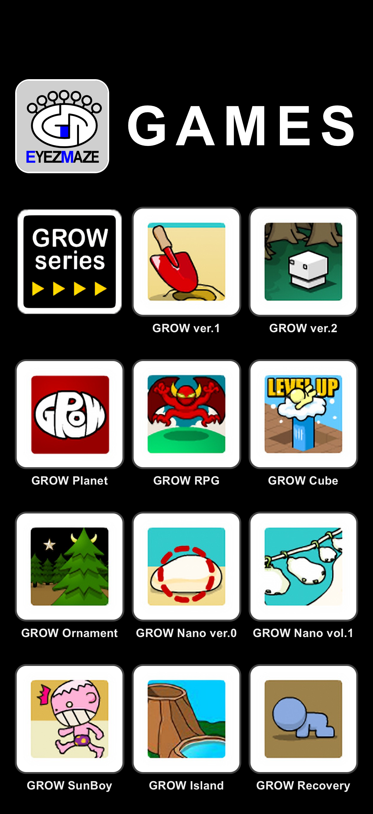 The menu</td>
<td width="25%">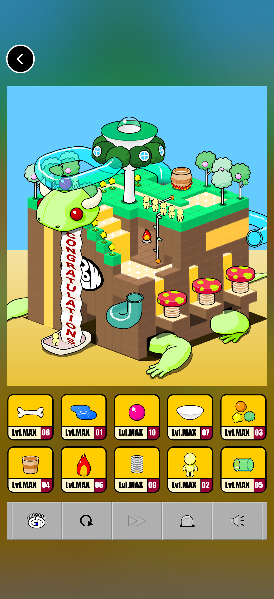 GROW Cube, laid out upright</td>
<td width="25%">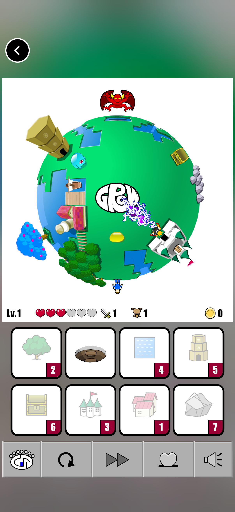 GROW RPG, laid out upright</td>
</tr>
</table>

<table>
<tr>
<td width="50%">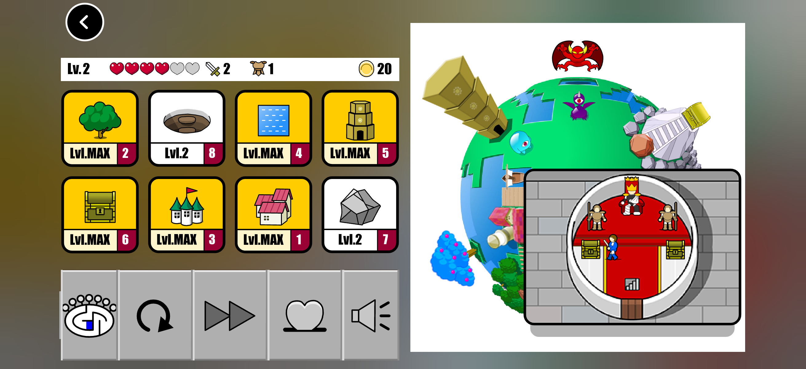 GROW RPG, sideways</td>
<td width="50%">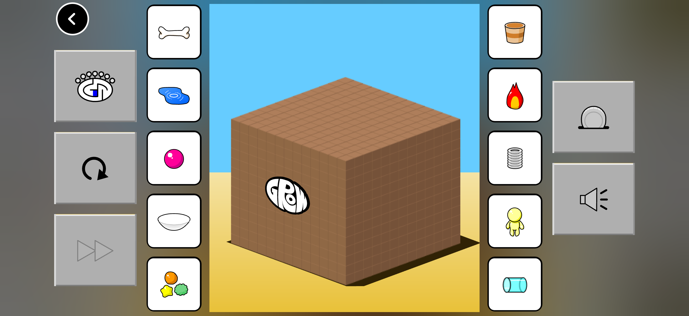 GROW Cube, sideways</td>
</tr>
</table>

### iPad

<table>
<tr>
<td width="50%">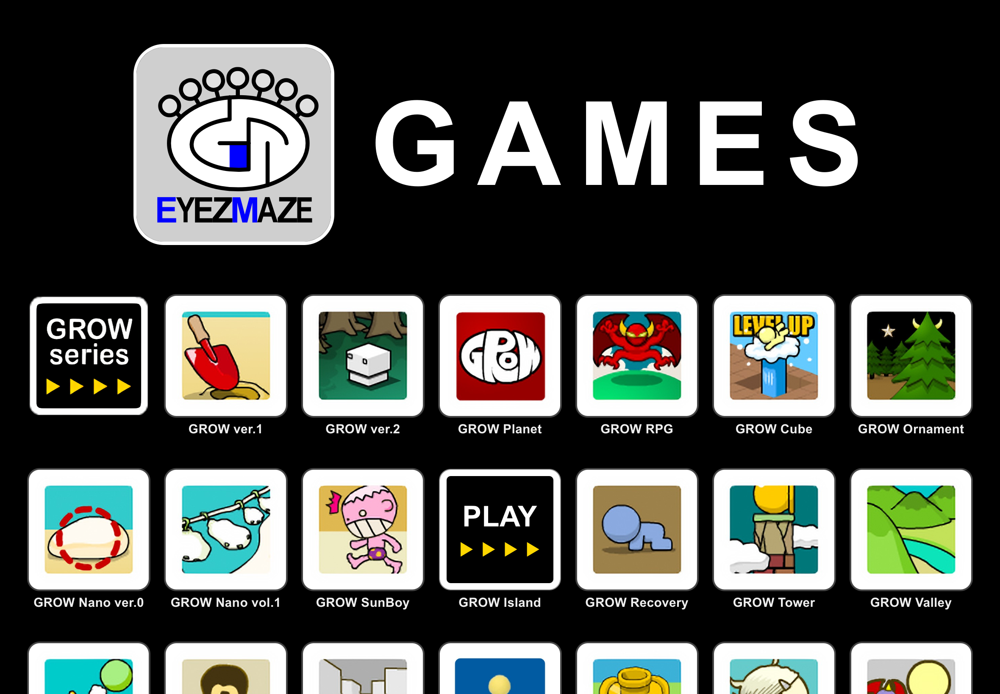 Tap a card and it turns to PLAY</td>
<td width="50%">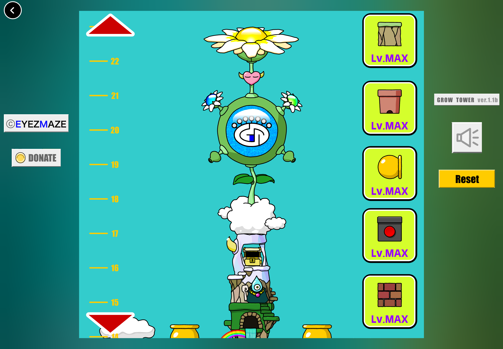 GROW Tower's iPad layout</td>
</tr>
<tr>
<td>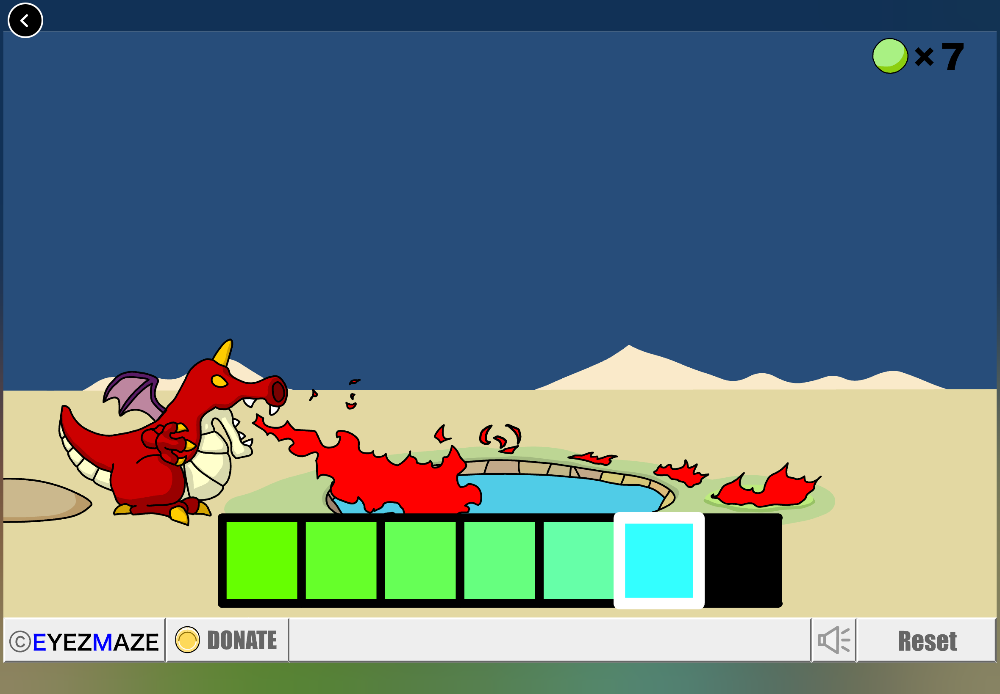 A web game, with its button bar redrawn sharp</td>
<td>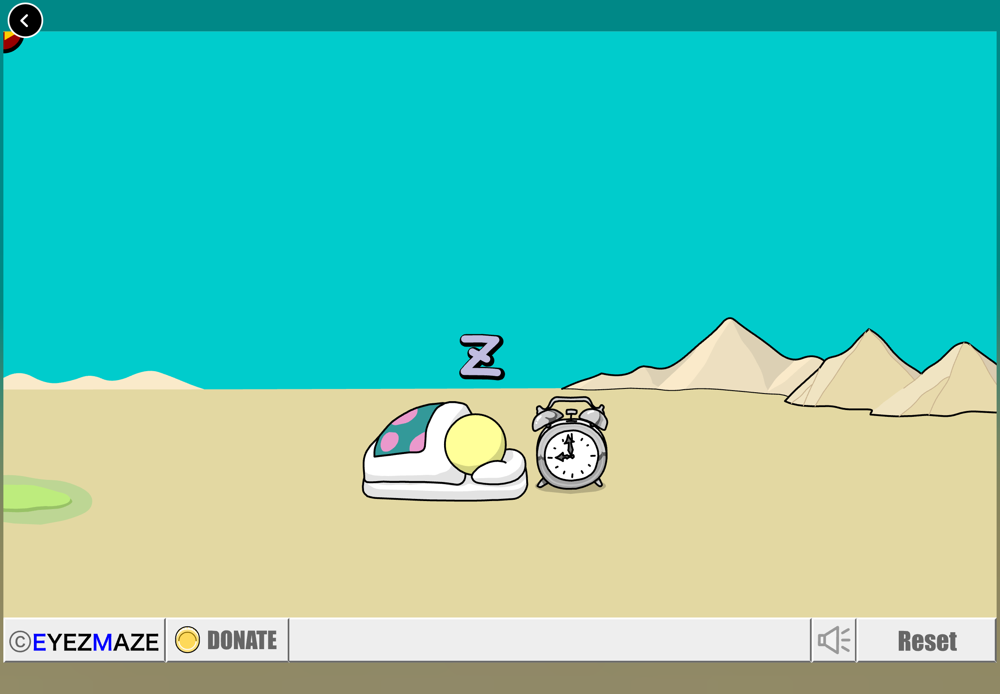 The glow round every game</td>
</tr>
</table>

---

## About

Remember GROW? You pick the order, drop the pieces in one by one, and watch a little world come alive, level by level, until everything reaches its peak. On Nakayama's EYEZMAZE games charmed players all over the world for twenty years. Then Flash was switched off for good at the end of 2020, and iPhones and iPads had never played Flash in the first place.

EYEZMAZE brings the whole collection to iPhone and iPad, made to fit your screen and your fingers. Every scene, character, rule and secret ending is exactly as the creator made it, with his permission.

| | |
|---|---|
| **Latest release** | [2.0](https://github.com/second-light/EYEZMAZE-App/releases/latest) (1 November 2026) |
| **Games** | 47: all 21 GROW games and 26 more EYEZMAZE classics |
| **Runs on** | iPhone, iPad and Mac |
| **Tested on** | iPhone 17 and iPad Air |
| **Frame rate** | About 60 fps |
| **Internet** | Not needed: every game is packed into the app |
| **Flash player** | [Ruffle](https://ruffle.rs), tuned for EYEZMAZE |

---

## Install

- **iPhone and iPad:** download the `.ipa` file from the [latest release](https://github.com/second-light/EYEZMAZE-App/releases/latest) and sideload it with **[Impactor](https://github.com/claration/impactor)**. The same file works on both.
- **Mac:** download the Mac `.zip` file from the same release, unzip it and open EYEZMAZE.

---

## What's inside

### 47 games in one place
- **All 21 GROW games,** from GROW ver.1 (2006) to GROW Valley, Tower, Cannon, RPG, Island, Maze, Clay, Cube, Ornament, Park, Cinderella and the Nano series.
- **26 more EYEZMAZE classics,** including Tontoko Tontie, Tontoko Family, Hatch, Hatch Today, Chronon, Vanilla, Black Box, Neighbours, Dwarf Complete, Galves Adventure and Jelly PoiPoi.
- **The creator's newer web editions.** Seven of the games need no Flash at all: GROW Planet, SunBoy, Recovery, Figure, Comeback, Thanks and DIET.
- **The newest versions of everything.** Sixteen games were older than the builds on eyezmaze.com, so they've been swapped for the creator's current editions, including remasters with taller stages.
- **Everything works offline.** The games are packed into the app, so you can play on a plane, on the bus or anywhere else.

### A menu based on his own front page
The menu is laid out the way eyezmaze.com shows On Nakayama's games.
- **Picture cards.** Every game is a picture card in a white rounded frame on black, with its name beneath.
- **Sorted into his series.** GROW and his other games are in separate blocks, each headed by his own signpost tile.
- **His logo across the top.** The logo and the word GAMES stretch across the top, exactly as wide as the cards below.
- **Sized for every screen:** three cards across on iPhone (five sideways), and five on iPad (seven sideways).
- **Cards that answer your finger.** A card dips a little under your finger and springs back.
- **Tap to turn, tap to play.** Tap a card and it turns over like a revolving door to show PLAY, with four yellow arrows beneath in the style of his GROW signpost. Tap again and its black spreads out to fill the screen as the game opens.
- **Easy to change your mind.** Tap another card, tap an empty space or scroll, and the turned card carries on round the same way back to its picture.
- **Right where you left it.** Come back from a game and the menu is where you were, with the game shrinking back into its card.
- **His website, one tap away.** The PC GAMEs and OTHERs signposts at the end open eyezmaze.com and his archive of animations and comics in Safari. The first tap turns the sign to show OPEN, so you never leave the app by accident.
- **Quick to load.** The whole menu is 1.5 MB, against the old hedge menu's 28 MB.

### A glow round every game
There are no black bars round a game. The game's own colours, softly blurred and darkened, fill the space around it while you play.
- **It follows the game,** drifting gently to new colours only when the scene changes.
- **Rearranged games sit right on the glow.** On iPhone and iPad, the panels and buttons moved to fit the screen sit straight on it, with no box behind them.
- **No black anywhere** except the back button, which is black with a white ring so it's easy to find.
- **It costs nothing.** Games run just as smoothly with the glow as without.

### An opening worth waiting for
A wall of game pictures greets you, flipping over like revolving doors to show game after game. Tap anywhere and every card falls away together, the GAMES panel and its logo with them, to reveal the menu standing behind. No flashes of white and no blank screens: the very first thing you see is the opening.

### A brand-new icon
The creator's own eye on his grey tile, in front of a wall of his game pictures. His logo was rebuilt from his original drawings as sharp vectors, so it's crisp at every size, from the home screen to the App Library.

---

## Built for your screen

These games were drawn for computer screens in landscape. On a phone held upright, most of them would shrink to a postage stamp. So, game by game, they've been laid out afresh. The pieces are shown in new places and at new sizes, but the pictures, rules and levels are untouched.

- **GROW Cube:** the cube runs across the full width, with the ten panels in two big rows beneath it.
- **GROW Valley:** the valley fills the width, with thumb-sized panels in two rows and the button bar split into two bigger rows. A GROW person who strolls from the valley into a panel's old spot stays perfectly visible.
- **GROW Planet:** twelve panels half as large again, in rows of four held upright, or beside the scene held sideways.
- **GROW RPG:** a closer view of the globe, panels a quarter larger, and the five buttons rebuilt bigger from their own faces and bevelled edges. Tap a panel and its picture flies to the globe from exactly where the panel now sits.
- **GROW Cannon:** played sideways, with the aiming boxes drawn 1.6 times bigger, about 50 points each.
- **GROW Tower:** panels 1.35 times larger, bigger scroll arrows and rebuilt buttons. Pierre still flies into the middle panel's place. On iPad held sideways it has a layout of its own, with narrower columns, so the tower stays nearly as tall as the screen.
- **GROW Island:** played sideways, with the island at full height and the bar's buttons down the two sides.
- **GROW ver.1 and ver.2:** the panels lifted out of the sand and the brown band, big under the scene or beside it, sitting straight on the glow. Even GROW ver.1's special one-panel moments switch layout by themselves.

Turn your phone and the layout turns with it, with both upright and sideways versions where a game suits both. On iPad every game is shown big and bold, and GROW Cannon, RPG, Planet and Tower fill the screen held sideways too. The Mac keeps every game exactly as the creator laid it out.

---

## Sharper than ever

Many of these games use small pictures that turn blurry when blown up to a modern screen. Not any more.

- **GROW Planet in HD.** Its whole picture sheet was enlarged and cleaned up, and the famous red ball redrawn perfectly round and smooth. No more speckles.
- **GROW ver.2's forest in HD.** Every tree, root and leaf was enlarged, with each edge traced into smooth curves. Every bark line and blade of grass stays where the creator put it, and built-in checks refuse any copy that loses or adds even a small patch.
- **Pin-sharp buttons in the web games.** In GROW Planet, Comeback, Figure, Recovery, SunBoy, Thanks and DIET, every button on the button bar is crisp: the EYEZMAZE eye, retry, skip, sound, tips and DONATE. They're the same pictures as the buttons in GROW Cube, so each was redrawn from his own drawings, eight times larger, in exactly the game's colours. The big START on the title screen is crisp too, traced from the game's own lettering.
- **Menu pictures true to his originals.** Every game's picture was enlarged by a more careful method and checked against his own icons, so nothing he didn't draw is added: no stray line across the little man's head in GROW Cube, no thick outlines round softer drawings such as PelPet, and Tontoko Tontie's pixel art keeps its pixels.
- **A clean eye on the opening screen.** A hidden line in the drawing showed through as a tiny dark mark in the white of the EYEZMAZE eye on iPad. Every line like it is now trimmed short.
- **Crisp text at any size,** using the same fonts the games were designed with, Japanese lettering included.
- **Lovingly restored details:**
  - GROW ver.1's sun finally has all its petals. One was left as a bare outline in the original file, so it's filled in with the creator's own drawing from his other files.
  - The egg on GROW Planet now matches its panel: green with lavender spots, right through to the moment it hatches.
  - Tontoko Family's greyed-out buttons, GROW Ornament's embossed "CONGRATULATIONS!" and Hatch Today's glowing "Flash" all show just as they did in Flash.

---

## Made for fingers

- **Big, touch-friendly buttons everywhere,** about 44 points and up, the size Apple recommends for a fingertip.
- **Drag to scroll in GROW Tower.** Slide the tower with your finger and it follows one to one. Flick it and it glides.
- **Two-tap aiming in GROW Cannon.** Tap once to aim and the view glides to where your shot will land; tap again to fire. Games built around a hovering mouse now work perfectly on a touchscreen.
- **Respects your silent switch.** Flip it and the game goes quiet.
- **The EYEZMAZE and DONATE buttons work in every game,** opening the creator's own website and support page in Safari. Please do support him!

---

## Every game, complete

Twenty years on, the web has changed around these games. Old servers are gone, files went missing, and some games refuse to start anywhere but their original website. Every single game was gone through and given everything it needed.

- **The missing pieces are back.** GROW ver.1 needs 16 scene files, and the collection had only 4. The other 12 came from eyezmaze.com, and 64 different routes through the game were played to prove every scene loads. GROW Maze's stages and GROW Clay's fourth stage are all there too.
- **GROW Clay's special ending unlocks again.** It used to need a sponsor's website that no longer exists; the app now answers that check itself.
- **High-score tables are back.** Tontoko Tontie and Hatch Today posted scores to a server that's long gone, so the app keeps your rankings itself.
- **Always in English.** Most of these games pick their language from their web address; the app makes sure every one chooses English.
- **Very tall games,** such as Vanilla and GROW Figure, are shown at a readable width and scroll, instead of being squashed.
- **Your progress is saved** for every game, between sessions.

---

## Under the bonnet

How do you play Flash games on a device that never played Flash? With [Ruffle](https://ruffle.rs), a modern rebuild of the Flash player, packed inside the app and tuned specially for EYEZMAZE.

- **The GROW Cube freeze is fixed.** Cube froze on real iPhones and iPads at its LEVEL UP moment. The game piles 145 instructions inside each other, and an iPhone only has room for about 93. This version of the player handles that deep pile in extra passes within the same frame, so the game looks exactly the same and never freezes.
- **The same picture as the Mac.** iPhone and iPad now draw games the Mac's way, so no Flash effects go missing.
- **Smooth as butter.** Measured at a steady 60 frames a second on iPhone 17 and iPad Air, through the opening, every turn of a card, scrolling, opening a game and coming back, with as little as 3 thousandths of a second of work per frame in the games. Every game still keeps the pace On Nakayama gave it.
- **Tested to the end.** Every one of the 47 games was played automatically on a real iPhone and iPad and checked for freezes, errors and stalls. The laid-out games were played right through to their endings: GROW Planet to both endings, GROW RPG and Tower to "CONGRATULATIONS", and GROW Cannon to its last shot.
- **Safe and private.** Games stay off the internet, links to the old website are blocked, and only the creator's own pages ever open, in Safari.

---

## Version history

<b>Show the development history</b>

**1 November 2026: Version 2.0**
- A new menu based on his own front page, with picture cards that turn over to PLAY.
- His PC GAMEs and OTHERs signposts open his website, and a line names him as the creator.
- A glow made from the game's own colours round every game, instead of the hedge.
- GROW Cannon, RPG, Planet and Tower fill the iPad held sideways.
- Sharp button bars and START in the seven web games.
- Menu pictures true to his originals.
- Fixed: the dark mark in the eye on the opening screen.

**1 November 2026: Version 1.0**
- First release, with everything below.

**19 October 2026**
- The app is now called EYEZMAZE, with a new icon and the creator's own logo.
- New opening: a wall of game pictures with revolving-door turnovers, falling away to reveal the menu.
- No more white or blue flashes before the opening.
- GROW ver.1 and ver.2 laid out for iPhone and iPad, with GROW ver.2's forest in HD.

**18 October 2026**
- New iPhone layouts for GROW Planet, RPG, Cannon and Tower, upright and sideways.
- Drag-to-scroll in GROW Tower, and two-tap aiming in GROW Cannon.
- The EYEZMAZE and DONATE buttons now work in every game.
- The menu: "GROW" spelt out in branches over the hedge, one sky behind it all, and brighter pictures.
- GROW Cube and GROW Valley laid out for iPhone and iPad.

**15 October 2026**
- Now available for iPhone and iPad.
- Fixed: GROW Cube freezing at LEVEL UP on iPhone and iPad.
- GROW Planet in HD, with a perfectly round red ball and an egg that matches its panel.
- GROW ver.1's sun gets its missing petal.
- iPhone and iPad draw games, effects and text exactly as the Mac does.

**13 October 2026**
- New game: Jelly PoiPoi.

**12 October 2026**
- The living hedge menu, with every game's own picture, the GROW people popping out of holes, trains and a rocket.
- A still hedge frames each game while you play.
- A quicker menu.

**8 October 2026**
- Every game made complete: missing scenes, English language, the right fonts and working high-score tables.
- Three new games: Tontirulin, Hatch Today and Vanilla.
- The creator's newest editions of every game, plus his web games.

---

## Coming soon
- **HD for every game,** as sharp as GROW Planet and GROW ver.2's forest.
- **More games laid out** for iPhone and iPad.
- **The planet menu** is set aside for now, not scrapped. The hedge menu is safely kept too, and can come back whenever it's wanted.

---

## Credits
- **Every game is by On Nakayama (EYEZMAZE),** [eyezmaze.com](https://www.eyezmaze.com).
- If you love these games, please support him with the DONATE button in any game.
- **[Ruffle](https://ruffle.rs),** the open-source Flash player rebuild, licensed MIT and Apache 2.0.
- App by **Second Light**.
